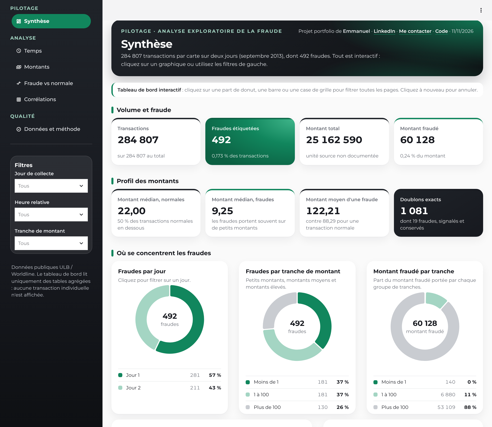
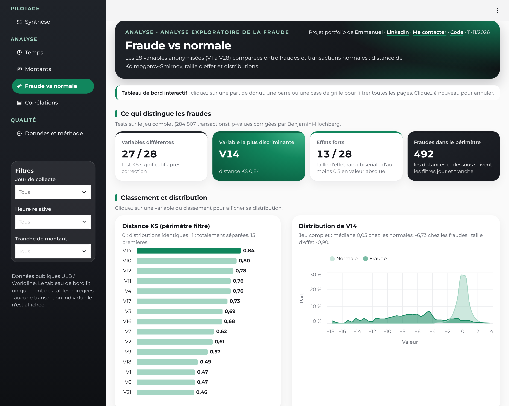

# Analyse exploratoire de la fraude par carte bancaire

[](https://github.com/mremmanuelgakpe-coding/credit-card-fraud-eda/actions/workflows/ci.yml)

> **Projet 1 du portfolio Data & IA : analyse exploratoire des données (EDA)**
> Problématique : *comment analyser les transactions bancaires pour identifier des schémas de fraude ?*

Analyse statistique de 284 807 transactions par carte (jeu public ULB / Worldline), dont 492 fraudes, et
**tableau de bord Streamlit interactif** pour la présenter à des non-spécialistes. Aucun modèle prédictif n'est entraîné :
le but est de comprendre les données et de formuler des hypothèses.

| | Résultat clé |
|---|---|
| Déséquilibre | **0,173 %** de fraudes (492 sur 284 807) |
| Montants | médiane **9,25** pour une fraude contre **22,00** pour une transaction normale ; 14 % des fraudes portent sur 1 ou moins |
| Temps | taux de fraude de **1,71 %** à l'heure relative 2 (10 fois la moyenne), quand l'activité est la plus faible |
| Variables | 27 des 28 composantes V diffèrent entre les classes ; **V14, V10, V12, V4, V11** séparent le mieux (distance KS de 0,76 à 0,84) |
| Qualité | 0 valeur manquante, 1 081 doublons exacts (dont 19 fraudes), signalés et conservés |

### Tableau de bord en ligne : [lien Streamlit à ajouter après déploiement](#lancer-le-projet)



---

## 1. Données

| | |
|---|---|
| Source | [Credit Card Fraud Detection](https://www.kaggle.com/datasets/mlg-ulb/creditcardfraud), ULB Machine Learning Group et Worldline, archivé sur [Zenodo (v1)](https://doi.org/10.5281/zenodo.7395559) |
| Contenu | 284 807 transactions de porteurs européens sur deux jours de septembre 2013 ; 31 colonnes |
| Variables | `Time` (secondes depuis la première transaction), `Amount` (unité non documentée), `Class` (1 = fraude), `V1` à `V28` (composantes d'ACP anonymisées par la source) |
| Intégrité | fichier vérifié par empreinte SHA-256 `76274b69…51a89` avant tout calcul |

**Le fichier brut n'est pas publié** (licence de redistribution non confirmée ; transactions individuelles). Le dépôt
et le tableau de bord ne contiennent que des **tables agrégées** ([détails](data/README.md)).

## 2. Méthode

1. **Contrôle qualité** : schéma, types, valeurs manquantes, doublons exacts, classes 0/1, montants et temps positifs.
   Une anomalie bloque le chargement : rien n'est supprimé en silence.
2. **Statistique univariée** : médiane, quartiles, asymétrie, valeurs atypiques (règle de l'écart interquartile).
3. **Statistique bivariée** : fraudes contre normales pour chaque variable, avec le test de **Mann-Whitney** (et sa
   taille d'effet rang-bisériale) et le test de **Kolmogorov-Smirnov** (distance KS). Les 30 p-values sont corrigées par
   **Benjamini-Hochberg**. Avec 284 807 lignes, presque tout est significatif : on lit d'abord la taille d'effet.
4. **Statistique multivariée** : corrélations de Spearman, profils jour × heure × tranche de montant.
5. **Publication agrégée** : `src/aggregates.py` produit, à partir du CSV vérifié, des tables sans aucune transaction
   individuelle. Les cellules de moins de 5 transactions sont fusionnées.

## 3. Résultats

| Variable | Médiane normales | Médiane fraudes | Taille d'effet | Distance KS |
|---|---|---|---|---|
| V14 | 0,05 | −6,73 | −0,90 | **0,84** |
| V10 | −0,09 | −4,58 | −0,83 | 0,80 |
| V12 | 0,14 | −5,50 | −0,87 | 0,78 |
| V4 | −0,02 | 4,18 | 0,88 | 0,77 |
| V11 | −0,03 | 3,59 | 0,84 | 0,76 |

Taille d'effet positive : valeurs plus élevées chez les fraudes. Tableau complet : [reports/aggregates/tests.csv](reports/aggregates/tests.csv).

**Lecture**
- **Montants** : les fraudes se concentrent aux deux extrémités. Beaucoup portent sur de petits montants (tests de carte),
  et le taux de fraude remonte au-dessus de 500. La tranche « montant nul » a le taux le plus élevé (1,49 %).
- **Temps** : l'heure relative 0 est la première transaction, pas minuit. Le creux d'activité des heures 1 à 6
  ressemble à la nuit ; c'est là que le taux de fraude est le plus fort (27 % des fraudes pour 10 % des transactions).
- **Variables V** : les fraudes ont des valeurs très décalées sur une dizaine de composantes. Chez les fraudes, ces
  composantes sont fortement corrélées entre elles (0,75 en moyenne contre 0,10 chez les normales) : les fraudes forment
  un profil cohérent.



**Hypothèses pour un futur modèle** (non testées ici) : V14, V10, V12, V4 et V11 devraient porter l'essentiel du signal ;
l'heure relative et les petits montants apportent un complément ; avec 0,17 % de fraudes, il faudra un découpage
chronologique et des métriques précision-rappel plutôt que l'exactitude.

## 4. Tableau de bord

Six pages, sur le modèle des autres projets du portfolio :

| Section | Page | Contenu |
|---|---|---|
| Pilotage | **Synthèse** | 8 indicateurs, donuts (fraudes par jour, par tranche, montant fraudé), taux de fraude par heure et par tranche, points d'attention calculés |
| Analyse | **Temps** | volume et taux de fraude par heure relative, grilles jour × heure |
| Analyse | **Montants** | distributions comparées (échelle logarithmique), tranches, grille tranche × moment de la journée |
| Analyse | **Fraude vs normale** | classement KS des 28 composantes (cliquable), distribution de la variable choisie, six petites distributions, tests complets |
| Analyse | **Corrélations** | matrices de Spearman (ensemble, fraudes, normales), taille d'effet de chaque variable |
| Qualité | **Données et méthode** | contrôles, statistiques univariées, démarche, hypothèses, limites |

**Filtrage croisé** : un clic sur une part de donut, une barre ou une case de grille filtre toutes les pages (jour,
heure relative, tranche de montant) ; un second clic annule. Les filtres actifs s'affichent en puces, chacun avec une
croix pour le retirer. Sans filtre, les médianes sont exactes ; avec filtres, elles sont approchées à partir des
histogrammes et marquées « ≈ ».

Police Montserrat servie localement (taille minimale 14 px), cartes blanches, palette verte du projet, liens LinkedIn,
contact et code dans l'en-tête.

## Lancer le projet

```bash
python3.12 -m venv .venv && source .venv/bin/activate
pip install -r requirements-dev.txt
streamlit run app.py                 # ou double-clic sur lancer_demo.command (macOS)
python -m pytest -q                  # 18 tests

# Régénérer les tables agrégées (nécessite data/creditcard.csv, voir data/README.md)
python -m src.aggregates
python scripts/generate_report.py
```

Le tableau de bord n'a pas besoin du CSV brut : il lit `reports/aggregates/`.

**En ligne** sur [Streamlit Community Cloud](https://share.streamlit.io) : dépôt, branche `main`, fichier `app.py`,
Python 3.12. Ne jamais téléverser `creditcard.csv`.

## Structure

```
├── app.py                         # tableau de bord : menu, en-tête, filtres
├── demo/common.py                 # palette, styles, filtres croisés, cartes, donuts, grilles
├── demo/views/                    # synthèse, temps, montants, fraude vs normale, corrélations, méthode
├── src/analysis.py                # contrôles, statistiques univariées, tests et corrections
├── src/aggregates.py              # tables agrégées publiables (aucune transaction individuelle)
├── notebooks/01_eda.ipynb         # parcours d'analyse (Matplotlib, Seaborn)
├── reports/                       # rapports et tables agrégées
├── scripts/generate_report.py     # rapport chiffré
├── tests/                         # 18 tests : analyse, tables agrégées, tableau de bord
└── static/fonts/                  # Montserrat (licence OFL)
```

## Limites

- Jeu historique : deux jours de 2013, porteurs européens. Les schémas de fraude ont évolué depuis.
- `V1` à `V28` sont anonymisées : aucune interprétation métier possible.
- `Time` est relatif et `Amount` n'a pas d'unité documentée : aucune heure civile ni devise n'est affichée.
- Des écarts statistiques ne prouvent aucune causalité. Les données ne contiennent ni identifiant de carte ni
  historique : impossible d'étudier la fréquence des transactions par porteur.

**Stack** : Python · pandas · NumPy · SciPy · Matplotlib · Seaborn · Altair · Streamlit · pytest · GitHub Actions

---

Emmanuel · [LinkedIn](https://www.linkedin.com/in/egakpe) · [me contacter](mailto:mremmanuelgakpe@icloud.com)
